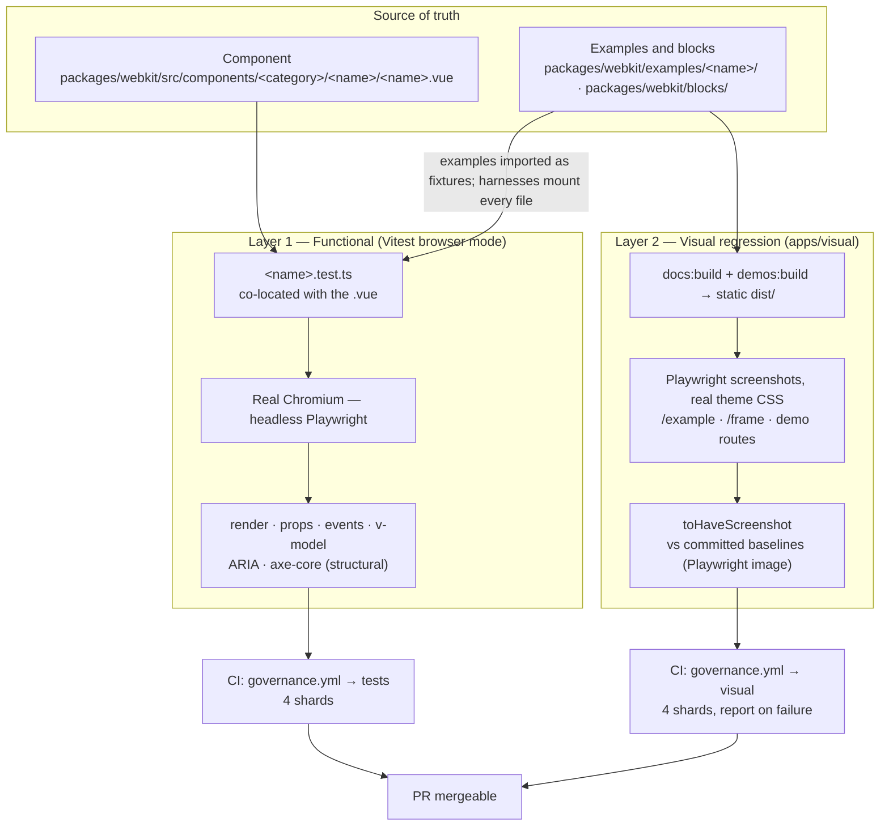
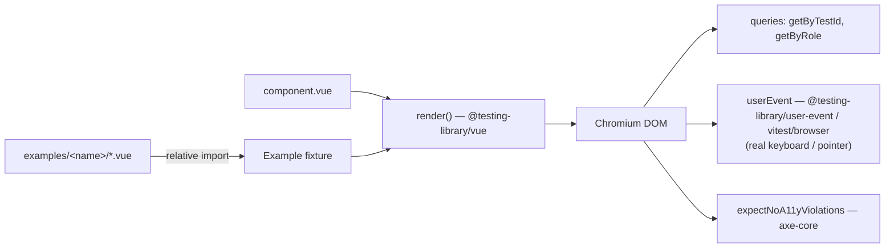
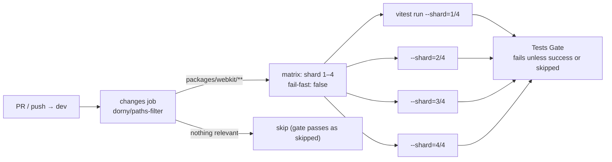

# Test Architecture — Overview

> **@aziontech/webkit monorepo** · snapshot of July 2026, visual layer updated November 2026 (M2.5: Storybook removed)
> Companion doc: [`OVERVIEW_LINT.md`](./OVERVIEW_LINT.md) (static-quality layers) · Deep audit: [`TESTING_AUDIT_2026-07-02.md`](./TESTING_AUDIT_2026-07-02.md)

## TL;DR

Webkit ships **two complementary test layers**, both running in **real Chromium** (never jsdom):

| Layer                    | Tooling                                     | DOM                                          | Owns                                                                                           | CI workflow                                                                                 |
| ------------------------ | ------------------------------------------- | -------------------------------------------- | ---------------------------------------------------------------------------------------------- | ------------------------------------------------------------------------------------------- |
| **1. Functional / unit** | Vitest 4 browser mode + Playwright          | Unstyled (tokens load, no Tailwind pipeline) | Behavior, structure, events, v-model, ARIA, structural a11y                                    | `package-webkit-test.yml` (4 shards)                                                        |
| **2. Visual regression** | Playwright `toHaveScreenshot` (`apps/visual`) over the built docs site and demos | Fully styled (theme + Tailwind)              | Pixels, layout, color, typography — light/dark at 1280 and 390 px (sampled matrix, §3) | `governance.yml` → `visual` (4 shards, Playwright image); baselines via `visual-baselines.yml` |

Current numbers: **67 component test suites · 1362 tests passing · 1 skipped · ~97% of in-scope component roots covered** — over a library of ~150 components (roots + sub-components).

The split is deliberate: **units prove it works, visual proves it looks right.** Neither layer pretends to do the other's job.

---

## 1. The big picture



Two ideas hold this together:

1. **The example is the fixture.** Tests import a component's examples from `packages/webkit/examples/<name>/` where they fit, and the harnesses (`src/test/copyable-sfcs.test.ts`, hydration, server render, `a11y-blocks-*`) mount every example and block file. The docs site renders the same files, so docs and tests cannot drift apart.
2. **One browser, two lenses.** Both layers run Chromium via Playwright. Layer 1 mounts components unstyled and asserts _what the DOM is and does_; Layer 2 renders the fully-styled docs site and demos and asserts _what the pixels look like_.

---

## 2. Layer 1 — Functional tests (Vitest browser mode)

### 2.1 Why a real browser, never jsdom

jsdom silently no-ops exactly the APIs component behavior depends on. A suite that passes there is a false positive for the things that break in production:

| Capability                              | jsdom        | Real Chromium |
| --------------------------------------- | ------------ | ------------- |
| `focus()` / `document.activeElement`    | no-op        | real          |
| Layout / `getBoundingClientRect`        | zeros        | real          |
| `<Teleport>` content in `document.body` | not surfaced | real          |
| Keyboard navigation / focus trap        | fake         | real          |
| Scroll-lock, overlay dismissal          | fake         | real          |

Consequence: **no mocks for layout, positioning, focus, or `<Teleport>` — ever.** If a test "needs" one of those mocks, the test is wrong.

### 2.2 The stack

| Piece         | File                                | What it does                                                                                                                                                                     |
| ------------- | ----------------------------------- | -------------------------------------------------------------------------------------------------------------------------------------------------------------------------------- |
| Runner config | `packages/webkit/vitest.config.ts`  | Vitest **4.1.9** browser mode: `provider: playwright()` (v4 factory), `headless: true`, single `chromium` instance, `retry: 2` in CI (0 local), includes `src/**/*.test.{ts,js}` |
| Global setup  | `packages/webkit/src/test/setup.ts` | `cleanup()` after each test + **anchor-navigation guard** (prevents `<a href>` clicks from tearing down the test iframe, while `@click` handlers still fire)                     |
| A11y helper   | `packages/webkit/src/test/axe.ts`   | `expectNoA11yViolations(container)` — runs **axe-core 4.10** and asserts zero violations                                                                                         |
| Coverage      | `vitest.config.ts` → `coverage`     | V8 provider, `text` + `lcov`, **reporting-only** (no gate yet); measures `src/components/**`, excludes tests, `.figma.ts`, barrels, presets                             |

### 2.3 Anatomy of a component test



The canonical shape:

```ts
import { render } from '@testing-library/vue'
import { describe, expect, it } from 'vitest'

import Default from '../../../../examples/avatar/default.vue'
import { expectNoA11yViolations } from '../../../test/axe'
import Avatar from './avatar.vue'

it('renders the Default example', () => {
  const { getByTestId } = render(Default)
  expect(getByTestId('content-avatar')).toHaveAttribute('role', 'img')
})

it('has no accessibility violations', async () => {
  const { container } = render(Avatar, { props: { label: 'AB' } })
  await expectNoA11yViolations(container)
})
```

Conventions that matter:

- **Co-location** — `<name>.test.ts` sits next to `<name>.vue`. Composition components are tested **through their root** (sub-components don't get their own file unless the root can't reach the behavior).
- **Example imports are relative paths** (never a vite alias) so the reference-validation hook can resolve them.
- Overlay content is queried from `document.body` (it really Teleports there), not from the render container.

### 2.4 The mandatory surface — what every test must cover

Fixed by [`.claude/rules/testing.md`](../.claude/rules/testing.md); this is the **floor**, not the ceiling:

| #   | Surface          | Assertion                                                                   |
| --- | ---------------- | --------------------------------------------------------------------------- |
| 1   | Render           | mounts; `data-testid` fallback present; consumer override wins              |
| 2   | Props / variants | each `kind` / `size` / … maps to its `data-*` attribute                     |
| 3   | Events           | every spec'd event fires with the right payload on real user action         |
| 4   | Suppression      | `disabled` / `loading` / `readonly` → action **not** emitted                |
| 5   | v-model          | drive the input, assert `update:modelValue` with the exact value            |
| 6   | ARIA             | `role`, `aria-expanded`, `aria-busy`, `aria-selected`… as declared          |
| 7   | a11y             | `expectNoA11yViolations` on default render + semantically-distinct variants |
| 8   | Composition      | context-aware sub-component reflects/drives the root's `provide`/`inject`   |
| 9   | Overlay          | open/close, `Escape` closes + returns focus, Teleport to body, scroll-lock  |
| 10  | Recursive        | ≥2-level nesting renders and propagates context                             |

### 2.5 The unstyled-DOM decision (and what axe checks)

The unit environment **does not run the Tailwind pipeline** — components mount with token variables loaded but no utility CSS generated. This is intentional (audit §2.0, "Path B"):

- Unit assertions are about **behavior, structure, and ARIA** — none of them need pixels.
- axe-core therefore runs **structural rules only**. Five visual/layout rules are explicitly disabled because they'd be meaningless without real styling: `color-contrast`, `color-contrast-enhanced`, `target-size`, `link-in-text-block`, `scrollable-region-focusable`.
- Structural axe still has teeth — it caught the suite's real defects (`nested-interactive`, `aria-required-children`, `aria-hidden-focus`).
- **Pixels and contrast belong to Layer 2**, where the full theme renders.

### 2.6 The quality bar — no false positives, no filler

- Assert **only what you read in the source**. Never invent props, events, testids, or ARIA.
- **Forbidden assertions:** Tailwind class strings, pixel positions, animation timing, internal component state. (If a test only passes when the implementation is written one specific way, it's a refactor trap — delete it.)
- A real component defect a test exposes → `it.skip` with a one-line reason and a note in the PR. Never fake a pass.

---

## 3. Layer 2 — Visual regression (styled, `apps/visual`)

Playwright serves the built docs site (`apps/docs/dist`) and demos (`apps/demos/dist`) and takes
screenshots with the real theme CSS. Specs and matrix:

| Spec | Pages | Modes |
| ---- | ----- | ----- |
| `examples.spec.ts` | `/example/<dir>/<file>`, the first example of every component | light 1280, dark 1280, light 390 |
| `blocks.spec.ts` | `/frame/<state>/<id>`, the primary state of every block; every state of `platform/ai/*` | light 1280, dark 1280, dark 390; AI blocks light/dark at 320 and 1280 plus right to left |
| `demos.spec.ts` | every demo route, plus the flows end to end | light 1280, dark 1280, dark 390; resource routes also right to left in pt-BR |
| `geometry.spec.ts` | styled geometry the unit layer cannot see (table presets, reorder mid-drag beside frozen columns, `OverflowCount` open, `OtpInput` at 320, account pieces) | per test |

Determinism: a fixed clock (2026-11-10 12:00 UTC), `timezoneId: 'UTC'`, `locale: 'en-US'`,
`reducedMotion: 'reduce'`, `animations: 'disabled'`, fonts awaited, and every request that is not
to `localhost` aborted. `maxDiffPixelRatio: 0.01`.

Baselines (`apps/visual/baselines/`) are committed and valid only when rendered in
`mcr.microsoft.com/playwright:v1.62.0-noble`, the image the CI job runs in. New examples, blocks
and demo routes are picked up from the files; only their baseline is a manual step
(`visual-baselines.yml`, `/regen-baselines`).

---

## 4. CI pipelines

### 4.1 Functional suite — `.github/workflows/package-webkit-test.yml`



- **4 shards** parallelize the ~150-component suite; `retry: 2` (from `vitest.config.ts`) absorbs the rare browser-launch flake.
- Playwright Chromium only (`playwright install --with-deps chromium`), with the browser binary cached on `pnpm-lock.yaml` (`~/.cache/ms-playwright`).
- The **gate job** (`test-check`) is the single required status — it passes when shards succeed _or_ the path filter skipped them.

### 4.2 Visual suite — `governance.yml` → `site` + `visual` jobs (+ `visual-baselines.yml` for baselines)

- The `site` job builds the docs site and the demos once and uploads both `dist/` folders.
- The `visual` job runs **in the Playwright image** (`mcr.microsoft.com/playwright:v1.62.0-noble`), sharded ×4 (`playwright test --shard=<i>/4`), after every upstream job; it downloads the built sites instead of rebuilding them.
- On failure it uploads the Playwright HTML report and `test-results/` (expected / actual / diff images).
- Baseline regeneration is dispatch-only via `.github/workflows/visual-baselines.yml`: `update_baselines=true` runs `--update-snapshots=all` in the same image and uploads `visual-baselines` to review and commit; the optional `grep` input narrows it.

### 4.3 Where the other gates sit

Static quality (ESLint, Stylelint, Prettier, `vue-tsc`, type-coverage, security scans, docs and demos build) runs in `governance.yml` — covered in [`OVERVIEW_LINT.md`](./OVERVIEW_LINT.md). One governance job matters here: **publish safety** (§5).

---

## 5. Publish safety — tests never ship to npm

Two mechanisms, verified in CI (`governance.yml` → build job):

1. `packages/webkit/package.json#files` negates test artifacts:
   ```json
   "files": ["src", "!src/**/*.test.{ts,js}", "!src/test/**", "package.json"]
   ```
2. `pack:check` asserts it:
   ```bash
   ! npm pack --dry-run 2>&1 | grep -E '\.test\.(ts|js)|src/test/'
   ```

`packages/webkit/tsconfig.json` also excludes `*.test.ts` and `src/test/` from declaration emit — no `.d.ts` is generated for test code.

---

## 6. Enforcement & scaffolding — how the floor stays enforced

| Mechanism                                                 | Kind                         | What it does                                                                                                                 |
| --------------------------------------------------------- | ---------------------------- | ---------------------------------------------------------------------------------------------------------------------------- |
| [`.claude/rules/testing.md`](../.claude/rules/testing.md) | Rule (source of truth)       | Fixes the browser-mode requirement, the 10-surface floor, and the hard prohibitions                                          |
| `enforce-test-exists.mjs`                                 | Claude Code PostToolUse hook | Warns when a root `.vue` is written without a co-located `<name>.test.ts`                                                    |
| `component-scaffold` skill                                | Generator                    | Every new component is born with a starter test (render + testid override + axe) that the author expands to the full surface |
| `validate-references.mjs`                                 | Claude Code PreToolUse hook  | Blocks test files whose imports don't resolve (e.g. a vite alias instead of a relative path)                  |
| `package-webkit-test.yml` gate                            | CI                           | No PR merges with a red shard                                                                                                |

---

## 7. Command cheat sheet

| Command (repo root)                 | What it runs                                    |
| ----------------------------------- | ----------------------------------------------- |
| `pnpm webkit:test`                  | full browser-mode suite, headless               |
| `pnpm webkit:test:watch`            | watch mode                                      |
| `pnpm webkit:test:ui`               | Vitest UI with a **headed** browser (debugging) |
| `pnpm webkit:test:coverage`         | suite + V8 coverage report (`text` + `lcov`)    |
| `pnpm visual:test`                  | styled screenshots vs baselines (after `docs:build` + `demos:build`) |
| `pnpm visual:update:baseline`       | dispatch the baseline workflow for this branch  |
| `pnpm --filter webkit pack:check`   | assert no test file leaks into the npm tarball  |

---

## 8. Design decisions — the "why" in one table

| Decision                                                              | Alternative rejected                                           | Rationale                                                                                                                                                                                                                                      |
| --------------------------------------------------------------------- | -------------------------------------------------------------- | ---------------------------------------------------------------------------------------------------------------------------------------------------------------------------------------------------------------------------------------------- |
| Vitest **browser mode** (real Chromium)                               | jsdom                                                          | jsdom no-ops focus/layout/Teleport — false positives on exactly the behaviors that break in production                                                                                                                                         |
| **Example as fixture** (`examples/<name>/*.vue`)                       | separate hand-written fixtures                                 | docs and tests exercise the same files; drift becomes impossible                                                                                                                                                                               |
| **Unstyled** unit DOM                                                 | wiring the Tailwind pipeline into Vitest                       | no unit assertion needs pixels; cost (postcss + theme config duplication) buys nothing — pixels are Layer 2's job                                                                                                                              |
| axe **structural-only** in units                                      | full axe rule set                                              | contrast/target-size without real CSS would mislead; structural rules caught every real defect so far                                                                                                                                          |
| **Snapshots of the built docs site and demos**, one container image   | visual SaaS (Chromatic etc.) / per-OS baselines                | self-hosted, zero external service; one image for local and CI removes font-rasterization noise |
| **Sampled matrix** (first example per component, primary block state, all AI-block states, demo routes) | every example × every mode | ~900 screenshots keep the run CI-sized; the geometry spec adds targeted shots where layout is fragile |
| **4-shard CI matrix** + retry 2                                       | single job                                                     | ~150-component suite parallelizes; retries absorb browser-launch flakes without hiding real failures                                                                                                                                           |
| Coverage **reporting-only**                                           | coverage gate                                                  | signal first, ratchet later — the functional floor (10 surfaces) is the real gate                                                                                                                                                              |
| Tests co-located, published-excluded                                  | separate `__tests__/` tree                                     | test lives with the component it proves; `files` negation + `pack:check` keep npm clean                                                                                                                                                        |
