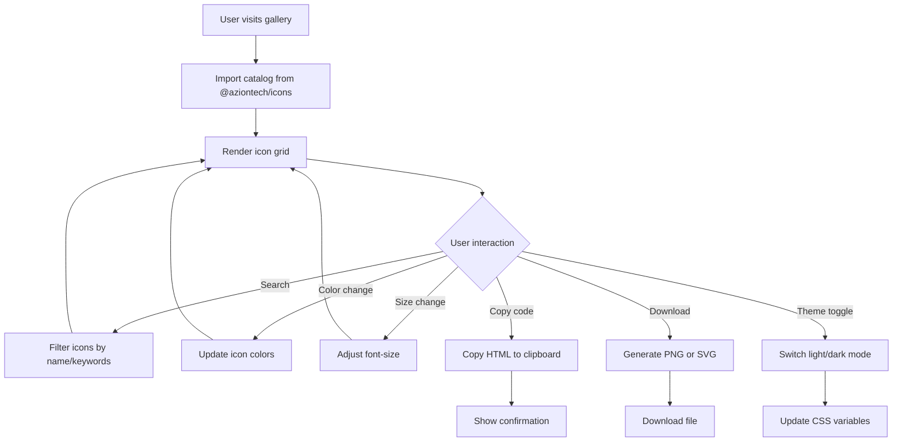
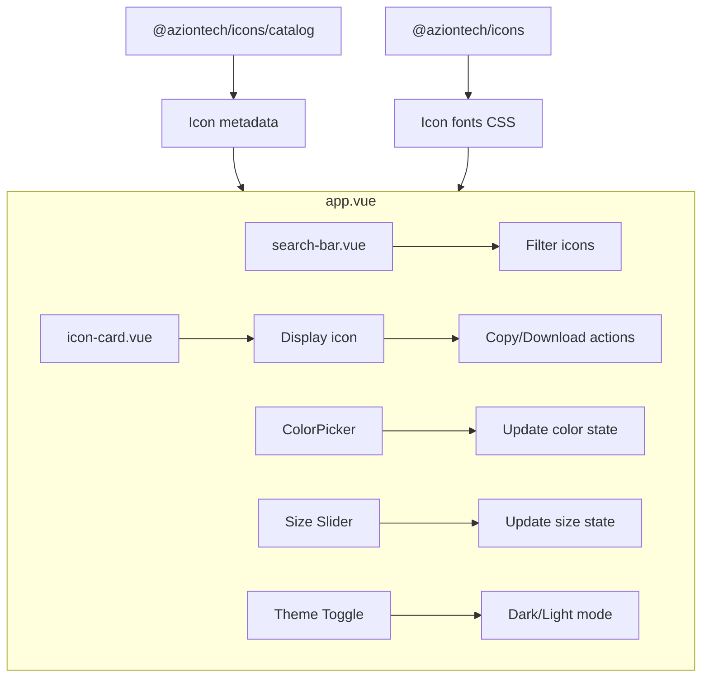
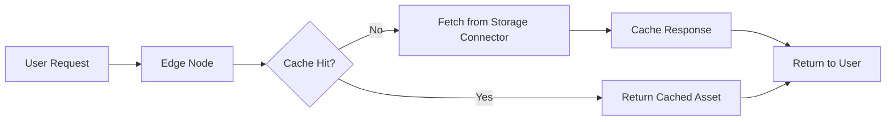

# Icons Gallery

> Visual showcase and documentation for **@aziontech/icons** — Azion's icon font library featuring azionicons (`az`) and colour logos (`az-color`).

[](LICENSE)
[](https://vuejs.org/)
[](https://vitejs.dev/)

---

## Overview

The Icons Gallery is a Vue 3 single-page application that provides an interactive visual reference for all icons available in the `@aziontech/icons` package. It allows developers to:

- **Search** icons by name or keywords
- **Preview** icons at different sizes (8px–320px)
- **Customize** icon colors using a color picker
- **Copy** icon HTML code to clipboard
- **Download** icons as PNG or SVG files
- **Toggle** between light and dark themes

The application is deployed on **Azion's Edge Platform** for low-latency global delivery.

---

## Architecture

### Technology Stack

| Layer            | Technology                                | Purpose                                    |
| ---------------- | ----------------------------------------- | ------------------------------------------ |
| **Framework**    | Vue 3 (Composition API, `<script setup>`) | Reactive UI components                     |
| **Build**        | Vite                                      | Dev server, bundling, preview              |
| **Styling**      | Tailwind CSS                              | Utility-first CSS framework                |
| **Icons**        | `@aziontech/icons`                        | Icon font + catalog (workspace dependency) |
| **Color Picker** | `vue3-colorpicker`                        | Color selection widget                     |
| **Testing**      | Vitest + happy-dom                        | Unit testing                               |
| **Deployment**   | Azion Edge Platform                       | Global edge deployment                     |

### Application Flow



### Component Architecture



---

## Project Structure

```
apps/icons-gallery/
├── public/
│   └── favicon.ico          # Site favicon
├── src/
│   ├── components/
│   │   ├── colored-icon.vue    # Colored icon preview
│   │   ├── icon-card.vue       # Individual icon display card
│   │   ├── icon-card.test.ts   # Icon card tests
│   │   └── search-bar.vue      # Search input with filtering
│   ├── lib/
│   │   └── theme.js         # Dark/light theme management
│   ├── styles/
│   │   └── main.css         # Global styles and Tailwind imports
│   ├── app.vue              # Main application component
│   └── main.js              # Application entry point
├── azion/
│   ├── args.json            # Build arguments for Azion CLI
│   └── azion.json           # Edge application manifest
├── azion.config.cjs         # Azion project configuration
├── index.html               # Vite HTML entry point
├── tsconfig.json            # Editor configuration (JavaScript allowed)
├── package.json             # Dependencies and scripts
├── postcss.config.js        # PostCSS configuration
├── tailwind.config.js       # Tailwind CSS configuration
├── vite.config.js           # Vite dev/build configuration
└── vitest.config.js         # Vitest test configuration
```

### Key Files Explained

| File                                                             | Purpose                                                                      |
| ---------------------------------------------------------------- | ---------------------------------------------------------------------------- |
| [`src/app.vue`](src/app.vue)                                     | Main component containing icon grid, controls, and state management          |
| [`src/components/icon-card.vue`](src/components/icon-card.vue)   | Renders individual icon with hover actions (copy code, copy image, download) |
| [`src/components/search-bar.vue`](src/components/search-bar.vue) | Search input with real-time filtering                                        |
| [`src/lib/theme.js`](src/lib/theme.js)                           | Theme initialization and toggle functionality                                |
| [`vite.config.js`](vite.config.js)                               | Vite dev server (port 3333) and build config                                 |
| [`vitest.config.js`](vitest.config.js)                           | Vitest config (happy-dom environment, co-located tests)                      |
| [`azion.config.cjs`](azion.config.cjs)                           | Edge deployment configuration with caching rules                             |

Icon metadata is **not** stored locally — it is imported at runtime from `@aziontech/icons/catalog` (resolved to `packages/icons/dist/catalog.json`).

---

## Getting Started

### Prerequisites

- Node.js 18+
- pnpm (workspace package manager)

### Installation

This app is part of a pnpm monorepo. From the workspace root:

```bash
# Install all workspace dependencies
pnpm install
```

### Development Server

```bash
# From the app directory
pnpm serve

# Or from workspace root
pnpm --filter @aziontech/icons-gallery serve
```

The app will be available at `http://localhost:3333` with HMR enabled (configured in `vite.config.js`).

### Build for Production

```bash
# Standard Vite build → ./dist
pnpm build

# Build optimized for Azion Edge Platform
pnpm build:azion
```

---

## Available Scripts

| Script                 | Description                                                    |
| ---------------------- | -------------------------------------------------------------- |
| `pnpm serve`           | Start Vite dev server with HMR on port 3333                    |
| `pnpm build`           | Build production bundle via Vite                               |
| `pnpm build:azion`     | Build optimized for Azion Edge Platform                        |
| `pnpm preview`         | Preview production build with Vite                             |
| `pnpm test:unit`       | Run Vitest unit tests once                                     |
| `pnpm test:unit:watch` | Run Vitest in watch mode                                       |
| `pnpm lint`            | Run ESLint with autofix                                        |
| `pnpm format`          | Format `src/` with Prettier                                    |
| `pnpm publish`         | Deploy to Azion Edge Platform (`azion deploy --local --debug`) |

---

## Configuration

### Vite (`vite.config.js`)

```javascript
import vue from '@vitejs/plugin-vue'
import { fileURLToPath, URL } from 'node:url'
import { defineConfig } from 'vite'

export default defineConfig({
  plugins: [vue()],
  resolve: {
    alias: { '@': fileURLToPath(new URL('./src', import.meta.url)) }
  },
  server: { port: 3333, open: true }
})
```

### Vitest (`vitest.config.js`)

```javascript
import { defineConfig } from 'vitest/config'
import vue from '@vitejs/plugin-vue'

export default defineConfig({
  plugins: [vue()],
  test: {
    environment: 'happy-dom',
    include: ['src/**/*.test.ts']
  }
})
```

### Tailwind CSS (`tailwind.config.js`)

```javascript
module.exports = {
  content: ['./index.html', './src/**/*.{vue,js,ts}']
  // Theme extensions defined inline.
}
```

### Azion Edge (`azion.config.cjs`)

Configures edge deployment with:

- **Storage connector** for static assets
- **Cache policies** (2-hour browser/edge TTL)
- **SPA routing** via rewrite to `index.html`
- **Static asset delivery** directly from edge storage

---

## Icon Showcase

The gallery displays every icon of `@aziontech/icons`, read from `@aziontech/icons/catalog` and `@aziontech/icons/color-catalog`. Icons come in three groups:

| Group     | What it holds                                                                                               | Example                             |
| --------- | ----------------------------------------------------------------------------------------------------------- | ----------------------------------- |
| Azion     | Products, product features, the platform (brand, CLI, API, pillars), solutions and services                 | `az az-functions`, `az az-edge-dns` |
| Interface | Arrows, actions, status, files, media, communication, commerce, people, devices, data, layout, objects, git | `az az-trash`, `az az-chevron-down` |
| External  | Third-party logos: frameworks, AI models, developer tools, languages, online services                       | `az az-react`, `az-color az-openai` |

Each card's keywords include the old class names, so `edge functions` finds `az az-functions` and `times` finds `az az-x`. What every icon shows and stands for is documented in [`packages/icons/docs/ICONS.md`](../../packages/icons/docs/ICONS.md), generated from `packages/icons/src/icons.json`.

## Adding New Icons

The gallery has no local icon list — it consumes the catalog generated by `@aziontech/icons`. To make new icons show up:

1. Add the icon to `packages/icons`: the SVG in `src/svg-raw/az` (or `az-color`) and its entry in `src/icons.json`.
2. Rebuild the icons package:
   ```bash
   pnpm --filter @aziontech/icons build
   ```
3. Restart the gallery dev server (`pnpm serve`) — the new icon appears automatically once `packages/icons/dist/catalog.json` is regenerated.

---

## Deployment

### Azion Edge Platform

```bash
# Build for edge deployment
pnpm build:azion

# Deploy (requires Azion CLI authentication)
pnpm publish
```

> The `publish` script in this app does **not** publish to npm — it calls `azion deploy --local --debug`. The name is preserved for legacy automation reasons.

#### Deployment Architecture



The deployment configuration includes:

- **Storage Connector**: Serves static assets from edge storage
- **Cache Policy**: 2-hour TTL for browser and edge cache
- **SPA Routing**: All routes rewrite to `index.html` for client-side routing

---

## Testing

```bash
# Run all unit tests once
pnpm test:unit

# Watch mode
pnpm test:unit:watch
```

Tests sit next to the source as `<name>.test.ts` and run on **Vitest** with the **happy-dom** environment.

### Current Coverage

| Module    | Tests                                                                    |
| --------- | ------------------------------------------------------------------------ |
| Icon card | Renders the name and its copy and download actions (`icon-card.test.ts`) |

---

## Contributing

### Development Workflow

1. **Create a feature branch** from `main`
2. **Make changes** following the existing code style
3. **Run linting and formatting**:
   ```bash
   pnpm lint
   pnpm format
   ```
4. **Run tests**:
   ```bash
   pnpm test:unit
   ```
5. **Submit a pull request** with a clear description

### Code Style

- Vue 3 Composition API with `<script setup>`
- Tailwind CSS utility classes for styling
- ESLint + Prettier for code formatting

---

## Related Packages

| Package                                              | Description                                          |
| ---------------------------------------------------- | ---------------------------------------------------- |
| [`@aziontech/icons`](../../packages/icons/README.md) | Icon font library (azionicons + colored brand icons) |

---

## License

[MIT](LICENSE) © 2026 Azion Technologies
