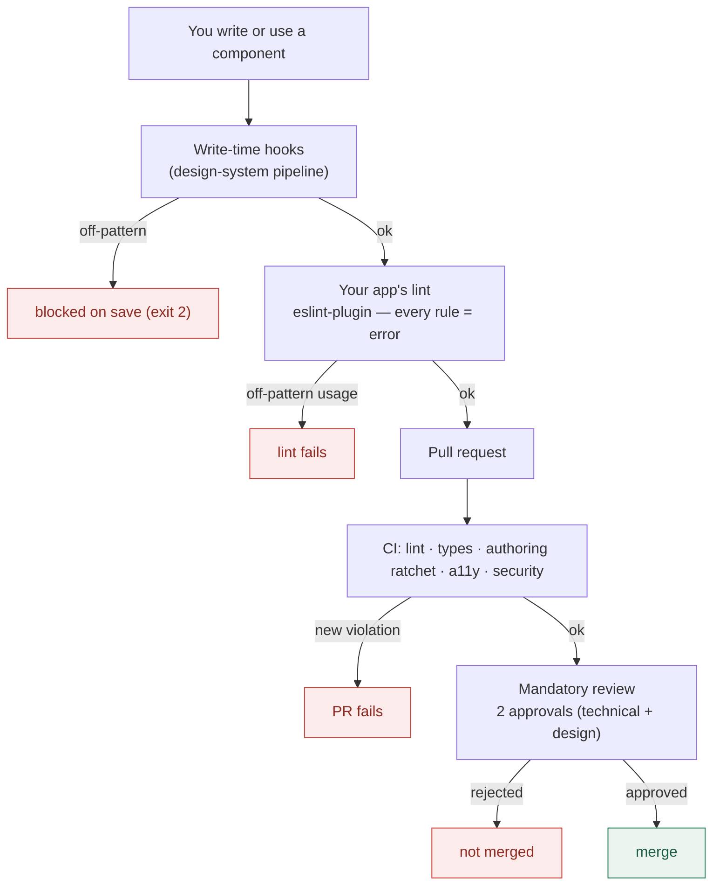

# Guidelines — building and using `@aziontech/webkit`

> This is the one-page digest. The **complete styleguide** — every code standard in full
> detail, with the gate that blocks each one — is [`STYLEGUIDE.md`](./STYLEGUIDE.md). The
> **end-to-end process map** (creation → release, adoption → enforcement) is
> [`PROCESS.md`](https://github.com/aziontech/webkit/blob/main/contributing/docs/PROCESS.md) (in the repository).

One page to **see every pattern** you need, whether you are:

- **A — building a component by hand** (in the design system or in your own project) → follow
  the **general construction patterns** below; or
- **B — using a webkit component in your project** → follow the **consumer rules** below.

Everything here is **enforced** — automatically (lint / CI) or by mandatory review — so the
pattern is the path of least resistance, not a checklist you have to remember. The machine-
readable source of these standards (and their `scope`) is
[`contributing/hooks/lib/standards.mjs`](../../../contributing/hooks/lib/standards.mjs); each rule
lives in [`contributing/rules/`](../../../contributing/rules/).

> **General vs. webkit.** The patterns in **Part A** are `scope: general` — they ship to your
> project and apply to any Vue component. The rules that are `scope: webkit` (spec-first
> pipeline, the exports map, examples and visual baselines, releases) live only inside the design
> system and are **not** on this page.

New to the design system? Start with the [Getting started](../README.md#getting-started)
(install, theme CSS, first component, playground) — this page is the pattern reference you
come back to.

---

## Principles

Every principle is held by a rule and a gate, not by memory. The rules ship in
`node_modules/@aziontech/webkit/rules/`.

| Principle                                | Rule                                               | Gate                                                                               |
| ---------------------------------------- | -------------------------------------------------- | ---------------------------------------------------------------------------------- |
| Every visual decision comes from a token | `webkit-tokens`, `webkit-styling`                  | `webkit/no-hardcoded-color`, `webkit/no-hardcoded-motion`, stylelint config, hooks |
| Use the system before building           | `webkit-prefer-over-custom`, `webkit-sections`     | `webkit/prefer-webkit-component`, review                                           |
| A component is used as shipped           | `webkit-style-override`                            | `webkit/no-style-override`                                                         |
| The spec is the source of truth          | the spec pipeline (`.specs/`, in the repository)   | spec hooks, `spec-status` and `catalog` gates                                      |
| Accessible by construction               | `webkit-accessibility`                             | `vuejs-accessibility` lint, axe in every component test                            |
| Small by default                         | `webkit-imports`, `webkit-performance`             | `webkit/no-barrel-import`, the size budget gate                                    |
| Enforced, not remembered                 | every rule names its gate                          | write-time hooks, `webkit check`, the CI ratchet                                   |
| Assets come from the bank                | `webkit-site-pages` (SD-13, SD-14, SD-18 to SD-20) | `webkit/no-root-relative-asset`, review                                            |

The layers: **foundations** (the `@aziontech/theme` tokens and the asset bank), **components**
(primitives, marketing and docs components, page sections), **blocks** (reviewed, copyable
screens under `blocks/`) and **assets** (brand marks, illustrations, diagrams, the icons of
`@aziontech/icons`).

## Where to check

Never answer a WebKit question from memory or from a copy in another document: read it at the
version the project has installed, and cite where it was read.

| Question                                          | Read                                                                                |
| ------------------------------------------------- | ----------------------------------------------------------------------------------- |
| Is WebKit installed and wired here?               | the project's `package.json` and `.mcp.json`, then `npx @aziontech/webkit doctor`   |
| How do I install, update, or add the CI gates?    | the package `README.md` and [`toolkit/CLI.md`](./toolkit/CLI.md)                    |
| Which component fits? Its API and import?         | the MCP: `suggest_component`, `list_components`, `get_component`; or `catalog.json` |
| Which screen do I start from?                     | the MCP `search_blocks` / `get_block`, or `npx @aziontech/webkit search` / `view`   |
| Is this import or class valid?                    | the MCP `get_import` / `validate_usage`, then the lint                              |
| Which token or asset?                             | the MCP `list_tokens` / `list_assets`, or `llms/foundations/`                       |
| Everything above without MCP                      | `llms/llms.txt` (one page per component, block and foundation); the docs site       |
| Which rule blocked this, and how do I fix it?     | the lint message, then `rules/webkit-*.md`                                          |
| A design rule for a product screen or a web page? | `/webkit-product-screens` (routing table) or rule `webkit-site-pages` (SD rules)    |
| Something not yet published?                      | the WebKit repository; never in place of the installed version                      |

When two sources disagree, the installed package wins over the docs site, and the docs site over
the repository's main branch: the package is what the project runs.

---

## Foundations — the tokens everything is built from

Every visual decision comes from a token. Raw values (hex, Tailwind palette names, raw
typography) are **blocked** by lint and hooks — the token is always the answer.

| Foundation     | Use                                                                                                                                         | Never                                                     |
| -------------- | ------------------------------------------------------------------------------------------------------------------------------------------- | --------------------------------------------------------- |
| **Color**      | `var(--primary)` · `var(--bg-surface)` · `var(--text-default)` · `var(--border-default)` · feedback `--success/--warning/--danger/--info`   | `#f3652b` · `text-blue-600` · `rgb(…)`                    |
| **Typography** | the generated classes — `text-heading-md`, `text-body-sm`, `text-button-lg`, `text-label-md` (font + size + line-height + tracking bundled) | `text-sm` · `leading-*` · `tracking-*` · `font-family`    |
| **Spacing**    | the semantic scale — `p-(--spacing-md)` · `gap-(--spacing-sm)` (`2xs…2xl`)                                                                  | primitive `--spacing-1…-96` · `p-4` when a token applies  |
| **Shape**      | `rounded-(--shape-button)` · `--shape-card` · `--shape-control`                                                                             | `rounded-lg` · numeric radii                              |
| **Shadow**     | `shadow-(--shadow-md)`                                                                                                                      | bare `shadow-md` · hex/rgb elevation                      |
| **Motion**     | catalogued `animate-*` utilities + `transition-*` with token durations; **every** motion class pairs with `motion-reduce:`                  | local `@keyframes` · `duration-[…]` · animation libraries |

Tokens are light/dark aware — using them is what makes a component theme correctly for free.
The full catalog lives in the theme package (`@aziontech/theme`) and renders on the docs
site's **Foundations** pages (`pnpm dev:docs`).

---

## Part A — building a component by hand (general patterns)

Each is a `scope: general` standard. Follow ✅, avoid ❌.

| Pattern                 | ❌ Avoid                                                             | ✅ Do                                                                                   |
| ----------------------- | -------------------------------------------------------------------- | --------------------------------------------------------------------------------------- |
| **Two-way value**       | `defineProps({ modelValue }) + emit('update:modelValue')`            | `const model = defineModel<string>()`                                                   |
| **Props**               | `defineProps({ variant: { type: String } })` · `kind` · `isDisabled` | `withDefaults(defineProps<Props>(), {…})` · `variant` · `disabled`                      |
| **Prop vocabulary**     | `sm/md/lg` · `kind` · `closeable`                                    | `small/medium/large` · `variant` · `dismissible`                                        |
| **Emits**               | `defineEmits(['click'])` · echo events (`value-change`)              | `defineEmits<{ 'item-click':[e,item] }>()` · `v-model`/`@update:*` only                 |
| **Event payloads**      | `emit('click', item)` · `{ value, event }` payload objects           | activation events emit `(event, item?)` — DOM event always first                        |
| **Slots**               | `<slot/>` with no declaration                                        | `defineSlots<{ default():unknown }>()`                                                  |
| **Composables**         | `return reactive({…})`                                               | `return { value: readonly(v), set }` · args via `toValue` · cleanup in `onScopeDispose` |
| **Styling**             | `const variantClasses = {…}` · `#f3652b` · `text-blue-600`           | `data-[variant=primary]:bg-(--primary)` inline · tokens only                            |
| **Component structure** | random `<script setup>` order                                        | fixed order: options → props → emits → models → slots → state                           |
| **Root element**        | wrapper `<div>` that swallows attrs · `as` prop                      | own the root · `inheritAttrs:false` + `$attrs` + `cn` · polymorphism via `href`         |
| **States**              | ad-hoc spinner / "no results" string                                 | `data-*` + `Skeleton` / `EmptyState`                                                    |
| **Accessibility**       | `<div @click>`                                                       | `<button>` + `focus-visible` + `motion-reduce:` + `useId`                               |
| **data-testid**         | (none)                                                               | `:data-testid="testId"` → the component's own name                                      |
| **Deprecation**         | remove/rename silently                                               | `@deprecated` (name the replacement + version) → one major → remove                     |

Each links to its full rule in [`contributing/rules/`](../../../contributing/rules/) (e.g. `v-model.md`,
`props.md`, `composables.md`) — the index is [`rules/README.md`](../../../contributing/rules/README.md).

### Folder structure — one component, one folder

A component named `<name>` lives in one predictable folder; two components differ only in
what they do, never in how their files are arranged:

```
<category>/<name>/
├── <name>.vue              # the root component (kebab file = canonical name)
├── index.ts                # compound API (composition only): Object.assign(Root, { Part })
├── injection-key.ts        # typed InjectionKey (composition only)
├── composables/            # composables specific to THIS component
│   └── use-<name>-context.ts
└── <name>-<part>/          # each public sub-component in its own folder
    └── <name>-<part>.vue
```

- **Co-locate** what only this component uses; promote to a shared `composables/` folder
  only when a second component needs it.
- **One component per `.vue` file**; the kebab file name is the canonical name everywhere
  (PascalCase in `defineOptions`, the kebab name itself in the testid).
- The **`<script setup>` order is fixed** too: imports → `defineOptions` → types → props →
  emits → models → slots → inject/composables → state → computed → watchers → functions →
  `defineExpose`.

---

## Part B — using a webkit component in your project

Install the ESLint plugin and enable the `recommended` preset — **every rule is `error`**, so
off-pattern usage fails your lint.

```js
// eslint.config.js
import webkit from '@aziontech/webkit/eslint-plugin'
export default [...webkit.configs.recommended]
```

| Do this                   | ❌ Avoid                                                | ✅ Do                                                    |
| ------------------------- | ------------------------------------------------------- | -------------------------------------------------------- |
| **Import**                | `import { Button } from '@aziontech/webkit'`            | `import Button from '@aziontech/webkit/button'`          |
| **No internal / typo**    | `@aziontech/webkit/src/…` · `…/buton`                   | `@aziontech/webkit/button`                               |
| **Tree-shaking**          | `import Table` (compound) when you only render the root | `import TableRoot from '@aziontech/webkit/table-root'`   |
| **Don't override styles** | `<Button class="p-8" />`                                | compose inside its slots, or use a `styleSeam` component |
| **No deprecated**         | importing a deprecated component                        | the suggested replacement                                |
| **Tokens, not colors**    | `class="text-[#fff]"`                                   | `class="text-(--text-default)"`                          |
| **Icons**                 | `import Icons from '@aziontech/icons'`                  | `import '@aziontech/icons'` (side-effect)                |

**Discover the API before you write it:** the webkit MCP server (`npx -y @aziontech/webkit-mcp@^6`, wired
into `.mcp.json` by `init`) answers
`list_components`, `get_component`, `list_tokens`, `suggest_component`, `get_best_practices`,
and `validate_usage` — so an AI (or you) gets the right import / token / prop _before_ the lint
has to reject the wrong one.

---

## How the standards are enforced

The lint blocks the wrong thing; the MCP + this guideline show the right thing. Nothing is a
suggestion — every pattern blocks the merge, automatically or by mandatory review.



**What happens at each step**

1. **Write-time** — as the component is written (by the AI pipeline or an editor with the
   hooks), a wrong pattern is blocked on save (`exit 2`): manual `v-model`, runtime
   `defineProps`, `<slot>` without `defineSlots`, off-token styling, phantom imports.
2. **Your app's lint** — the `@aziontech/webkit` ESLint plugin (all rules `error`) blocks
   wrong _usage_: barrel imports, deep imports, style overrides, deprecated components.
3. **CI** — the authoring **ratchet** re-runs the write-time checks over the changed source and
   fails the PR on any new violation; `lint` / `types` / `a11y` / `security` run alongside.
4. **Mandatory review** — the parts a regex cannot verify (behavioural a11y, `defineExpose`
   minimality, state-matrix completeness) are gated by the 2 required approvals; the PR cannot
   merge without them.

The result: the standard is applied by construction, checked independently, and blocked when
violated — so a component reaches review already on-pattern, and a consumer stays on-pattern
in their own build.
